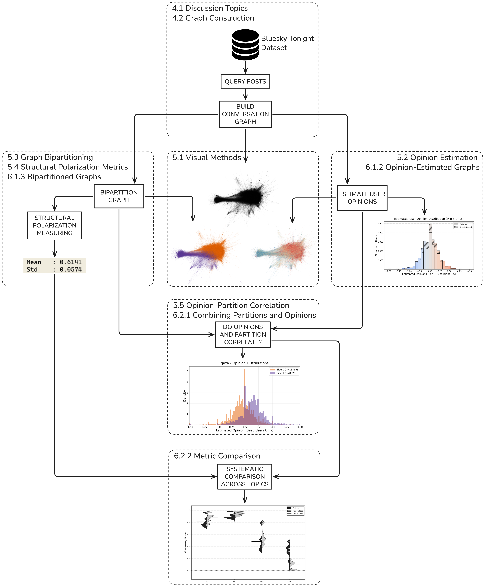

# quantifying-controversy-bluesky
Python code for the Master's thesis "Quantifying Controversy on Bluesky".

The code can be mapped unto specific parts of the following pipeline:

## Data

The data which are the results of querying the [Bluesky Tonight](https://zenodo.org/records/14669616) as part of this work are hosted here: https://zenodo.org/records/24583860

This data is to be placed inside the datasets/topics directory.

## Environment

Use the pyproject.toml to create a `uv` Python environment. Run files via `uv run -m absolute.path.to.file`. 

